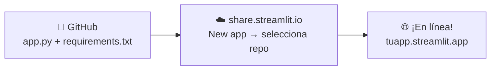
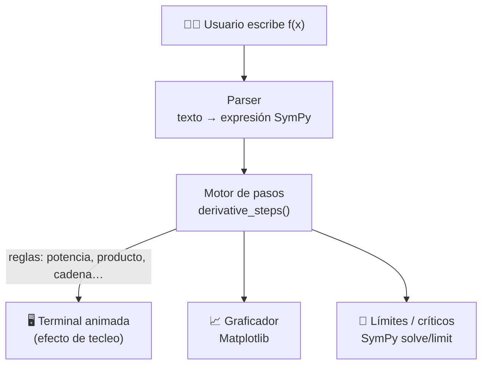

<div align="center">

# 🧮 CalcDiff — Solucionador de Cálculo Diferencial

### *Resuelve problemas de cálculo diferencial paso a paso, como si un profesor los escribiera en la pizarra — pero tecleando como un computador.*

**SymPy · Streamlit · Matplotlib**


</div>

---

## 📚 ¿Qué es CalcDiff?

**CalcDiff** es una aplicación web educativa que **resuelve problemas de cálculo diferencial mostrando el procedimiento completo**, regla por regla, hasta llegar al resultado — con la experiencia visual de una **terminal que va tecleando** la solución a un ritmo controlado por el usuario.

No solo entrega la respuesta: **muestra la ruta**. Cada paso nombra la regla aplicada (potencia, producto, cociente, cadena...), la fórmula correspondiente y el resultado intermedio. Además, **grafica** la función, su derivada y las rectas tangentes para entender el problema visualmente.

---

## ✨ Características

| 🔥 Característica | Descripción |
|---|---|
| 🖥️ **Terminal animada** | La solución se "teclea" en pantalla, con velocidad ajustable — ni tan rápido ni tan lento |
| 📐 **Motor simbólico real** | SymPy calcula derivadas, límites y raíces **exactas**, no aproximaciones |
| 📝 **Paso a paso detallado** | Cada regla se nombra con su fórmula: potencia, producto, cociente, regla de la cadena... |
| 📈 **Graficador integrado** | f(x), f′(x), recta tangente y punto de tangencia, con estilo oscuro |
| 🎯 **Clasificación automática** | Máximos y mínimos con el criterio de la segunda derivada |
| 🧪 **6 capítulos** | Todo el núcleo de un curso de cálculo diferencial |
| 💰 **100% gratis** | Código abierto, desplegado gratis en Streamlit Cloud |

---

## 📖 Capítulos cubiertos

| # | Capítulo | Qué hace la app |
|---|---|---|
| **1** | 🟦 Derivada por reglas | Potencia, suma/resta, producto, cociente y constante — con la regla nombrada en cada paso |
| **2** | 🟪 Regla de la cadena | Detecta funciones compuestas y muestra u, u′ y la composición |
| **3** | 🟧 Recta tangente y normal | Deriva, evalúa la pendiente en x = a y construye la ecuación punto–pendiente |
| **4** | 🟥 Puntos críticos | Resuelve f′(x) = 0 y clasifica cada punto como máximo, mínimo o inflexión con f′′ |
| **5** | 🟨 Análisis completo | Tablas de signos de f′ (crecimiento) y f′′ (concavidad), puntos de inflexión |
| **6** | 🟩 Límites | Sustitución directa, detección de indeterminaciones, límites laterales por ambos lados |

---

## 🚀 Despliegue en 3 pasos (Streamlit Cloud)



### Paso a paso

1. **Sube los archivos** a un repositorio de GitHub (ver estructura abajo)
2. Ve a **[share.streamlit.io](https://share.streamlit.io)** → inicia sesión con GitHub → **New app**
3. Selecciona: tu **repositorio** → rama **`main`** → archivo **`app.py`** → **Deploy** ✅

> 🔄 La app se **redespliega automáticamente** con cada `git push`. Sin servidores, sin costos, sin dolor.

### Ejecución local

```bash
git clone https://github.com/tuusuario/calcdiff.git
cd calcdiff
pip install -r requirements.txt
streamlit run app.py
```

La app abre automáticamente en `http://localhost:8501`.

---

## 📂 Estructura del repositorio

```
calcdiff/
├── .streamlit/
│   └── config.toml      # Tema oscuro nativo de Streamlit
├── app.py               # La aplicación completa
├── requirements.txt     # Dependencias
└── README.md            # Este documento
```

**requirements.txt**
```
streamlit
sympy
matplotlib
```

**.streamlit/config.toml** — tema oscuro de acento azul que combina con el diseño:
```toml
[theme]
base = "dark"
primaryColor = "#58a6ff"
backgroundColor = "#0b0f1a"
secondaryBackgroundColor = "#0d1322"
textColor = "#e6edf3"
```

> 💡 El `app.py` ya incluye su propio CSS moderno (hero con gradiente, terminal estilo macOS con cursor parpadeante, tarjetas de resultado y sidebar con marca); el `config.toml` redondea la experiencia aplicando el fondo oscuro a toda la interfaz.

---

## ⌨️ Sintaxis de entrada

La app acepta notación matemática natural de SymPy:

| Quiero escribir | Escribo |
|---|---|
| x³ − 3x + 2 | `x**3 - 3*x + 2` (o `x^3 - 3*x + 2`) |
| sen(x² + 1) | `sin(x**2 + 1)` |
| ln(x)·cos(x) | `ln(x)*cos(x)` |
| eˣ | `exp(x)` o `e**x` |
| √(x² + 4) | `sqrt(x**2 + 4)` |
| π | `pi` |

**Funciones disponibles:** `sin`, `cos`, `tan`, `asin`, `acos`, `atan`, `sinh`, `cosh`, `tanh`, `exp`, `ln` (o `log`), `sqrt`, `Abs`

---

## 🎮 Cómo se usa

1. Elige el **capítulo** en el panel izquierdo
2. Escribe la función o **selecciona un ejemplo** del desplegable
3. Ajusta la **velocidad del tecleo** con el deslizador (5–80 ms)
4. Pulsa **▶ Resolver y mostrar pasos**
5. Observa la terminal teclear la solución y la gráfica generarse al lado

---

## 🛠️ Tecnologías

| Capa | Herramienta | Rol |
|---|---|---|
| Motor matemático | **SymPy** | Derivación simbólica, simplificación, límites, solución de ecuaciones |
| Interfaz | **Streamlit** | App web en Python puro, despliegue gratuito en Streamlit Cloud |
| Graficado | **Matplotlib** | Gráficas de f, f′ y tangentes con estilo oscuro |
| Lenguaje | **Python 3.9+** | — |

---

## 🧩 Arquitectura



- **`parse_fn()`** — convierte el texto en expresión simbólica (acepta `^` y `**`)
- **`derivative_steps()`** — deriva recursivamente registrando la regla aplicada en cada nodo; las sub-reglas anidadas se propagan a la lista raíz
- **`type_terminal()`** — renderiza progresivamente la solución con el efecto de tecleo
- **`plot_fn()`** — construye la gráfica con f, f′ y la tangente
- **`full_analysis()`** — f′ y f′′ para los capítulos de análisis

---

## 📜 Licencia

Proyecto con fines educativos bajo licencia **MIT**. Úsalo, modifícalo y compártelo libremente — ideal como material de apoyo para cursos de cálculo diferencial.

---

<div align="center">

**⭐ Si te sirvió, deja una estrella en el repositorio ⭐**

*Hecho con 🧠 + ❤️ para estudiantes de cálculo*

</div>
